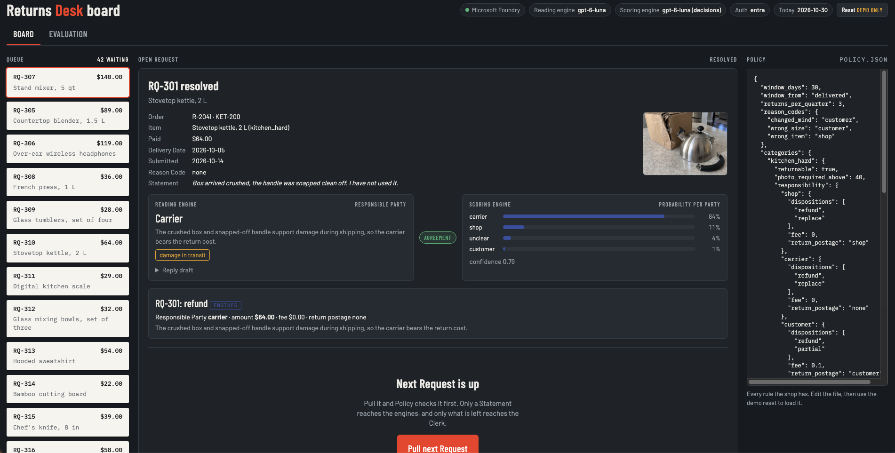

# Returns Desk

Retailers modernizing how they serve customers usually start with what customers see, such as a
self-service returns portal. What the customer actually gets is decided behind it: whether the
return is approved, who bears the cost, and how fast they hear back. Returns Desk is a demo of
that decision layer for Larkfield Home & Apparel, a fictitious retailer of kitchenware and
clothing.

The desk draws the line between work a rule can do and work that needs a model. Policy answers
everything a table can answer; the one question no table holds, who is the responsible party for
a customer's statement, goes to two Microsoft Foundry engines; and a clerk decides what is left.
A Keyva demo, built to show where generative AI belongs in a business process and where plain
code is the better tool.

Everything runs on real Azure resources: there is no offline mode. The tests are the exception
and need no cloud account.

## What you need

- An Azure subscription where you can create resources and assign roles (Owner, or
  Contributor plus User Access Administrator), with the Azure CLI signed in (`az login`).
- [uv](https://docs.astral.sh/uv/), which installs Python 3.12 or later for you.
- [OpenTofu](https://opentofu.org/) for the infrastructure.

## Quickstart

1. **Try the tests, no Azure needed.** From `app/`: `uv run pytest`.
2. **Create the Foundry resources.** From `infra/`: copy `terraform.tfvars.example` to
   `terraform.tfvars` and fill it in, then `tofu init` and `tofu apply`. This creates a
   resource group, a Foundry account with a gpt-6-luna deployment, and a role assignment that
   lets your `az login` identity call it. Key auth stays off.
3. **Point the app at it.** Run `tofu output -raw app_env` and paste the `export` lines into
   your shell.
4. **Open the board.** From `app/`: `uv run returns-desk serve`, then go to
   http://127.0.0.1:8080/.
5. **Walk the demo.** Follow the five-minute script in `docs/SKETCH.md`, section 9. Each of the
   seven demo requests takes a different branch: denied by policy, mapped from a reason code,
   auto-approved by the engines, or sent to the clerk.
6. **Clean up.** `tofu destroy` in `infra/` when you are done.

## Commands

All run from `app/` with `uv run returns-desk <command>`:

| Command | What it does |
|---|---|
| `serve` | Opens the returns board on http://127.0.0.1:8080/. `--port` or `PORT` changes the port. |
| `run` | Walks the queue at the terminal, asking you to act as the clerk where needed. |
| `evaluate` | Runs both engines over every labeled request and writes `data/evaluation.json`, which the board's evaluation page shows. About 80 engine calls, billed at real token prices. |
| `reset` | Empties the resolution log, so the queue fills again. The board's reset button does the same. |

Every command takes `--today` to set the desk's date (see below) and `-v` for debug logging.

## Configuration

`tofu output app_env` sets the first three. The rest are optional.

| Variable | Meaning |
|---|---|
| `RETURNS_DESK_ENDPOINT` | The Foundry account's endpoint. Required. |
| `RETURNS_DESK_DEPLOYMENT` | The model deployment both engines call. Required. |
| `RETURNS_DESK_MODEL` | The model name, used to price token usage on the board. |
| `RETURNS_DESK_DECISION_DEPLOYMENT` | A separate deployment for the probabilistic engine, if you want one. |
| `RETURNS_DESK_API_KEY` | Use an API key instead of your Entra sign-in. Needs `local_auth_enabled = true` in `infra/`. |
| `RETURNS_DESK_DECISION_API_KEY` | An API key for the probabilistic engine only. |
| `RETURNS_DESK_TODAY` | The desk's date, ISO format. Defaults to 2026-10-30, the sample set's date, so the demo tells the same story whenever you run it. |
| `PORT` | The board's port. |

## Where to read

- `CONTEXT.md` - the glossary; the names used everywhere in this repo.
- `docs/SKETCH.md` - the design, the behavior of each part, the demo queue and the demo script.
- `docs/PHOTO-PROMPTS.md` and `app/data/photos/PROMPTS-USED.md` - how the sample photos were
  made. Every photo is AI-generated; none shows a real customer's item.
- `docs/brand/` - the Larkfield logo and colors. Larkfield is fictitious; any resemblance to a
  real company is unintended.
- `CONTRIBUTING.md` - how to work on the code, test-first.

## Layout

- `app/` - the Python package `returns_desk`, its tests, sample data and Dockerfile.
- `infra/` - OpenTofu for the Foundry resources; `infra/hosting/` for the container hosting layer.
- `docs/` - the design sketch, the photo prompts and the board screenshot.

## Deploy the board to Azure

To run the board in Azure Container Apps instead of on your machine, after the quickstart's
step 2:

1. From `infra/hosting/`: copy `terraform.tfvars.example` to `terraform.tfvars`, taking
   `resource_group_name` and `foundry_account_name` from `tofu -chdir=.. output`. Then
   `tofu init` and `tofu apply -target=azurerm_container_registry.acr` to create the registry
   first.
2. From the repo root, run the command printed by
   `tofu -chdir=infra/hosting output -raw build_command`. It builds the image in the cloud, so
   no local Docker is needed.
3. Back in `infra/hosting/`, `tofu apply`. The board is at `tofu output board_url`, behind
   Entra ID sign-in.

The Foundry layer has been applied and destroyed cleanly. The hosting layer has not yet been
run end to end, so treat these steps as the intended order rather than a tested script.
`tofu destroy` in `infra/hosting/` and then in `infra/` removes everything.

## Safeguards and limits

This is a demo, not a production returns system. Before reusing the pattern:

- **Sign-in is the only access control.** The board has no auth of its own; the hosting layer
  puts Entra ID sign-in in front of it and admits only the principals in
  `signin_principal_ids` (by default, whoever ran the apply). With `require_signin = false`,
  anyone on the internet can pull requests, resolve them, reset the demo and spend tokens.
- **The engines are not a security boundary.** Both read the same customer statement, so text
  written to mislead one can mislead both, and their agreement proves nothing. What bounds the
  damage is code: the auto-approval cap in `policy.json` ($75 by default), the responsibility
  table, and the validator, which never lets a refund exceed what was paid. Statements here come
  only from the sample set; if you accept customer-written text, keep those limits and treat the
  statement as untrusted input.
- **Costs.** Engine calls are billed per token and capped in rate by the deployment's 10K TPM
  quota. The hosting layer keeps one container replica running and a Basic registry, which cost
  money while deployed whether or not anyone uses the board. The optional budget only sends
  alerts; Azure does not stop spending when it is reached.
- **From demo to production.** A real rollout connects the desk to the order management system,
  the payment platform and carrier claims; records which clerk approved each refund; keeps the
  resolution log in a database rather than a file on the container; lets many clerks work at
  once; and measures the engines on the retailer's own labeled returns before raising any limit.
- **Network.** The Foundry account accepts calls from the public internet, authenticated with
  Entra ID (key auth is off by default). Lock it down with private networking for anything
  beyond a demo.

## License

MIT. See `LICENSE`.
